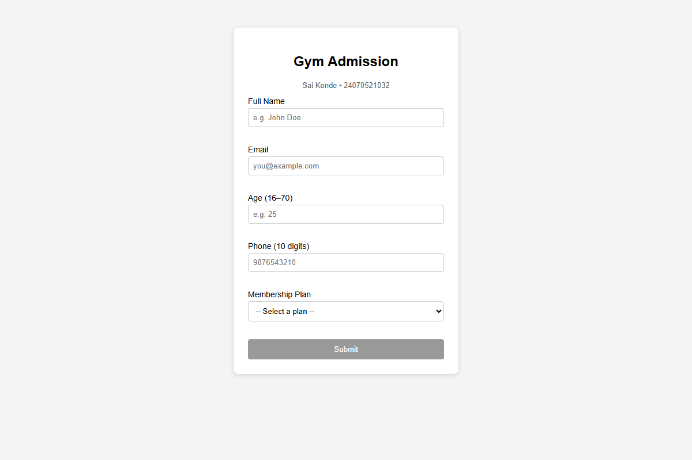

# Experiment No. 8

**Student Name:** sai konde
**PRN:** 24070521032

---

## Experiment Title
Form Validation using JavaScript Events

## Software / Tools Required
1. Visual Studio Code
2. Google Chrome
3. HTML5
4. JavaScript (ES6)

---

## Experiment Program Code

### `prac8` — Gym Admission Form with Live Validation

> See code in `prac8` file.

The form implements:
- **Live validation** on `input` and `blur` events for each field
- **Validation rules** for Name (≥3 chars), Email (regex), Age (16–70), Phone (10 digits), Plan (required)
- **Submit button** disabled until all fields are valid
- **Visual feedback** with green/red border classes (`.valid` / `.invalid`)

---

## Output
- A Gym Admission form with 5 fields: Full Name, Email, Age, Phone, Membership Plan.
- Each field validates in real-time as user types (`input` event) and on leaving the field (`blur` event).
- Submit button is disabled until all validations pass.
- On successful submission, an alert confirms admission.

### Screenshot

---

## Result / Conclusion
The practical was completed successfully. JavaScript form validation using events (`input`, `blur`, `change`, `submit`) was implemented. A Gym Admission Form was developed that validates all fields in real-time, provides visual feedback (green/red borders and error messages), and only enables the submit button when all validations pass.
