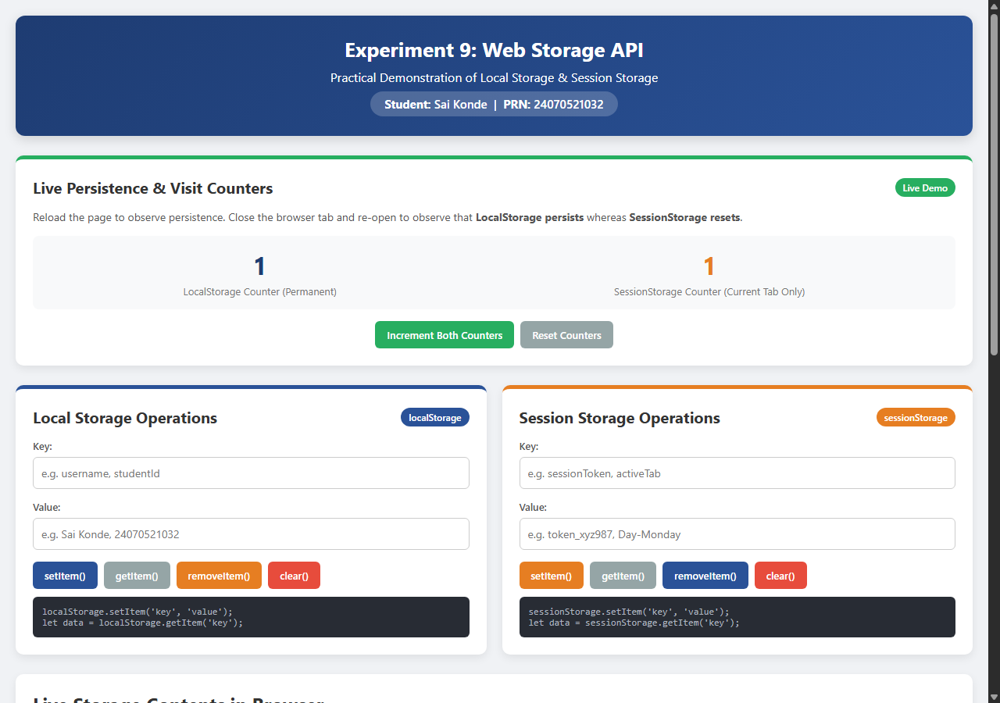
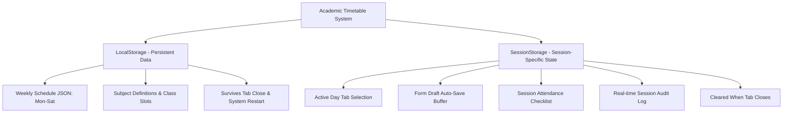
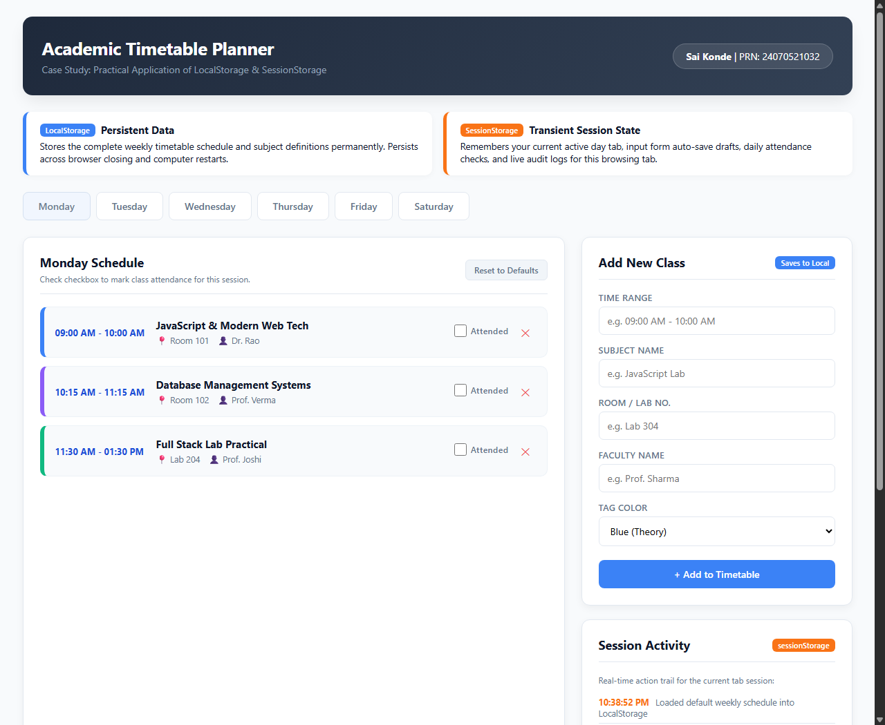

# Experiment No. 9

**Student Name:** Sai konde  
**PRN:** 24070521032  

---

## Experiment Title
Web Storage API: Implementation of Local Storage and Session Storage with a Timetable Case Study

---

## Software / Tools Required
1. Visual Studio Code
2. Google Chrome / Any modern browser
3. HTML5
4. CSS3
5. JavaScript (ES6)

---

## Overview of Web Storage API

HTML5 Web Storage enables web applications to store data locally within the user's browser in key-value pairs without transmitting data to the web server across HTTP requests.

### Comparison: `localStorage` vs `sessionStorage`

| Feature | `localStorage` | `sessionStorage` |
| :--- | :--- | :--- |
| **Persistence** | Data persists indefinitely until explicitly cleared by script or browser cache wipe. | Data is automatically cleared as soon as the page session ends (tab or browser window is closed). |
| **Scope** | Shared across all tabs, windows, and iframes with the same origin (`protocol://host:port`). | Scoped strictly to the specific window/tab where the session originated. |
| **Storage Capacity** | Typically 5MB to 10MB per origin. | Typically 5MB per origin/tab. |
| **Network Overhead** | Stored locally; not sent with HTTP requests (unlike HTTP cookies). | Stored locally; not sent with HTTP requests. |
| **Primary Use Cases** | User preferences, persistent application data, themes, offline cache. | Single-session state, form drafts, temporary filter selection, wizard steps. |

---

## Task 9.1 — Implementation of Local Storage and Session Storage

### Aim
To demonstrate the core operations of the Web Storage API (`setItem`, `getItem`, `removeItem`, `clear`, and persistence testing) using both `localStorage` and `sessionStorage`.

### File Path
`task9/prac9.html`

### Program Code

#### `task9/prac9.html`
```html
<!DOCTYPE html>
<html lang="en">
<head>
    <meta charset="UTF-8">
    <meta name="viewport" content="width=device-width, initial-scale=1.0">
    <title>Experiment 9 - Local Storage & Session Storage</title>
    <style>
        * {
            box-sizing: border-box;
            margin: 0;
            padding: 0;
            font-family: 'Segoe UI', Tahoma, Geneva, Verdana, sans-serif;
        }

        body {
            background: #f0f2f5;
            color: #333;
            padding: 20px;
        }

        .header {
            background: linear-gradient(135deg, #1e3c72, #2a5298);
            color: white;
            padding: 25px;
            border-radius: 12px;
            text-align: center;
            box-shadow: 0 4px 15px rgba(0,0,0,0.15);
            margin-bottom: 25px;
        }

        .header h1 {
            font-size: 26px;
            margin-bottom: 8px;
        }

        .student-info {
            display: inline-block;
            background: rgba(255, 255, 255, 0.2);
            padding: 6px 18px;
            border-radius: 20px;
            font-size: 15px;
            font-weight: 500;
        }

        .grid {
            display: grid;
            grid-template-columns: repeat(auto-fit, minmax(360px, 1fr));
            gap: 20px;
            margin-bottom: 25px;
        }

        .card {
            background: white;
            border-radius: 10px;
            padding: 22px;
            box-shadow: 0 4px 12px rgba(0,0,0,0.08);
            border-top: 5px solid #2a5298;
        }

        .card.session {
            border-top-color: #e67e22;
        }

        .card.counter-card {
            border-top-color: #27ae60;
        }

        .card h2 {
            font-size: 20px;
            margin-bottom: 15px;
            display: flex;
            align-items: center;
            justify-content: space-between;
        }

        .badge {
            font-size: 12px;
            padding: 4px 10px;
            border-radius: 12px;
            font-weight: 600;
            color: white;
        }

        .badge-local { background: #2a5298; }
        .badge-session { background: #e67e22; }
        .badge-success { background: #27ae60; }

        .form-group {
            margin-bottom: 14px;
        }

        label {
            display: block;
            margin-bottom: 6px;
            font-weight: 600;
            font-size: 13px;
            color: #555;
        }

        input, textarea, select {
            width: 100%;
            padding: 10px;
            border: 1px solid #ccc;
            border-radius: 6px;
            font-size: 14px;
            transition: border-color 0.2s;
        }

        input:focus, textarea:focus {
            outline: none;
            border-color: #2a5298;
        }

        .btn-group {
            display: flex;
            gap: 8px;
            flex-wrap: wrap;
            margin-top: 15px;
        }

        button {
            padding: 9px 15px;
            border: none;
            border-radius: 6px;
            cursor: pointer;
            font-weight: 600;
            font-size: 13px;
            transition: all 0.2s ease;
        }

        button:hover {
            opacity: 0.9;
            transform: translateY(-1px);
        }

        .btn-primary { background: #2a5298; color: white; }
        .btn-warning { background: #e67e22; color: white; }
        .btn-danger { background: #e74c3c; color: white; }
        .btn-secondary { background: #95a5a6; color: white; }
        .btn-success { background: #27ae60; color: white; }

        .counter-box {
            display: flex;
            justify-content: space-around;
            text-align: center;
            padding: 15px;
            background: #f8f9fa;
            border-radius: 8px;
            margin-bottom: 15px;
        }

        .count-val {
            font-size: 32px;
            font-weight: bold;
            color: #1e3c72;
        }

        .count-label {
            font-size: 13px;
            color: #777;
            margin-top: 4px;
        }

        .table-card {
            background: white;
            border-radius: 10px;
            padding: 22px;
            box-shadow: 0 4px 12px rgba(0,0,0,0.08);
            margin-bottom: 25px;
        }

        table {
            width: 100%;
            border-collapse: collapse;
            margin-top: 15px;
        }

        th, td {
            padding: 11px;
            text-align: left;
            border-bottom: 1px solid #eee;
            font-size: 14px;
        }

        th {
            background-color: #f8f9fa;
            color: #444;
            font-weight: 600;
        }

        .status-msg {
            margin-top: 12px;
            padding: 10px;
            border-radius: 6px;
            font-size: 13px;
            display: none;
        }

        .status-success {
            background: #d4edda;
            color: #155724;
            border: 1px solid #c3e6cb;
            display: block;
        }

        .comparison-table td:first-child {
            font-weight: 600;
            width: 25%;
        }

        .code-snippet {
            background: #282c34;
            color: #abb2bf;
            padding: 12px;
            border-radius: 6px;
            font-family: monospace;
            font-size: 12px;
            overflow-x: auto;
            margin-top: 10px;
        }
    </style>
</head>
<body>

    <div class="header">
        <h1>Experiment 9: Web Storage API</h1>
        <p style="margin-bottom: 8px;">Practical Demonstration of Local Storage & Session Storage</p>
        <div class="student-info">
            <strong>Student:</strong> Sai Konde &nbsp;|&nbsp; <strong>PRN:</strong> 24070521032
        </div>
    </div>

    <!-- Counters Demonstration -->
    <div class="card counter-card" style="margin-bottom: 25px;">
        <h2>
            <span>Live Persistence & Visit Counters</span>
            <span class="badge badge-success">Live Demo</span>
        </h2>
        <p style="font-size: 14px; color: #555; margin-bottom: 15px;">
            Reload the page to observe persistence. Close the browser tab and re-open to observe that <strong>LocalStorage persists</strong> whereas <strong>SessionStorage resets</strong>.
        </p>
        <div class="counter-box">
            <div>
                <div class="count-val" id="localVisitCount">0</div>
                <div class="count-label">LocalStorage Counter (Permanent)</div>
            </div>
            <div>
                <div class="count-val" style="color: #e67e22;" id="sessionVisitCount">0</div>
                <div class="count-label">SessionStorage Counter (Current Tab Only)</div>
            </div>
        </div>
        <div class="btn-group" style="justify-content: center;">
            <button class="btn-success" onclick="incrementCounters()">Increment Both Counters</button>
            <button class="btn-secondary" onclick="resetCounters()">Reset Counters</button>
        </div>
    </div>

    <!-- Storage CRUD Controls Grid -->
    <div class="grid">
        <!-- Local Storage Demo -->
        <div class="card">
            <h2>
                <span>Local Storage Operations</span>
                <span class="badge badge-local">localStorage</span>
            </h2>
            <div class="form-group">
                <label for="localKey">Key:</label>
                <input type="text" id="localKey" placeholder="e.g. username, studentId">
            </div>
            <div class="form-group">
                <label for="localVal">Value:</label>
                <input type="text" id="localVal" placeholder="e.g. Sai Konde, 24070521032">
            </div>
            <div class="btn-group">
                <button class="btn-primary" onclick="setLocalItem()">setItem()</button>
                <button class="btn-secondary" onclick="getLocalItem()">getItem()</button>
                <button class="btn-warning" onclick="removeLocalItem()">removeItem()</button>
                <button class="btn-danger" onclick="clearLocal()">clear()</button>
            </div>
            <div id="localStatus" class="status-msg"></div>
            <div class="code-snippet">
localStorage.setItem('key', 'value');<br>
let data = localStorage.getItem('key');
            </div>
        </div>

        <!-- Session Storage Demo -->
        <div class="card session">
            <h2>
                <span>Session Storage Operations</span>
                <span class="badge badge-session">sessionStorage</span>
            </h2>
            <div class="form-group">
                <label for="sessionKey">Key:</label>
                <input type="text" id="sessionKey" placeholder="e.g. sessionToken, activeTab">
            </div>
            <div class="form-group">
                <label for="sessionVal">Value:</label>
                <input type="text" id="sessionVal" placeholder="e.g. token_xyz987, Day-Monday">
            </div>
            <div class="btn-group">
                <button class="btn-warning" onclick="setSessionItem()">setItem()</button>
                <button class="btn-secondary" onclick="getSessionItem()">getItem()</button>
                <button class="btn-primary" onclick="removeSessionItem()">removeItem()</button>
                <button class="btn-danger" onclick="clearSession()">clear()</button>
            </div>
            <div id="sessionStatus" class="status-msg"></div>
            <div class="code-snippet">
sessionStorage.setItem('key', 'value');<br>
let data = sessionStorage.getItem('key');
            </div>
        </div>
    </div>

    <!-- Live Storage Viewer Table -->
    <div class="table-card">
        <h2>Live Storage Contents in Browser</h2>
        <p style="font-size: 14px; color: #666;">Real-time inspection of browser memory for current origin.</p>
        
        <h3 style="margin-top: 20px; font-size: 16px; color: #1e3c72;">LocalStorage Items</h3>
        <table id="localTable">
            <thead>
                <tr>
                    <th style="width: 50px;">#</th>
                    <th style="width: 250px;">Key</th>
                    <th>Value</th>
                    <th style="width: 100px;">Action</th>
                </tr>
            </thead>
            <tbody id="localTableBody">
                <tr><td colspan="4" style="text-align: center; color: #888;">No items in LocalStorage</td></tr>
            </tbody>
        </table>

        <h3 style="margin-top: 25px; font-size: 16px; color: #e67e22;">SessionStorage Items</h3>
        <table id="sessionTable">
            <thead>
                <tr>
                    <th style="width: 50px;">#</th>
                    <th style="width: 250px;">Key</th>
                    <th>Value</th>
                    <th style="width: 100px;">Action</th>
                </tr>
            </thead>
            <tbody id="sessionTableBody">
                <tr><td colspan="4" style="text-align: center; color: #888;">No items in SessionStorage</td></tr>
            </tbody>
        </table>
    </div>

    <!-- Difference Table -->
    <div class="table-card">
        <h2>Key Differences: LocalStorage vs SessionStorage</h2>
        <table class="comparison-table">
            <thead>
                <tr>
                    <th>Feature</th>
                    <th>localStorage</th>
                    <th>sessionStorage</th>
                </tr>
            </thead>
            <tbody>
                <tr>
                    <td>Lifetime</td>
                    <td>Persists indefinitely until explicitly cleared via script or user cache wipe.</td>
                    <td>Cleared automatically as soon as the tab or window is closed.</td>
                </tr>
                <tr>
                    <td>Scope</td>
                    <td>Shared across all tabs and windows with the same origin (protocol, host, port).</td>
                    <td>Scoped to the specific browser tab/window where it was created.</td>
                </tr>
                <tr>
                    <td>Storage Limit</td>
                    <td>~5MB - 10MB per origin depending on browser.</td>
                    <td>~5MB per tab session.</td>
                </tr>
                <tr>
                    <td>Server Communication</td>
                    <td>Never sent to server with HTTP requests (unlike Cookies). Stays on client.</td>
                    <td>Never sent to server with HTTP requests. Stays on client.</td>
                </tr>
            </tbody>
        </table>
    </div>

    <script>
        // Initialize Counters
        function updateCountersOnLoad() {
            let localCount = parseInt(localStorage.getItem('exp9_visit_count') || '0', 10);
            localCount++;
            localStorage.setItem('exp9_visit_count', localCount);
            document.getElementById('localVisitCount').innerText = localCount;

            let sessionCount = parseInt(sessionStorage.getItem('exp9_session_visit_count') || '0', 10);
            sessionCount++;
            sessionStorage.setItem('exp9_session_visit_count', sessionCount);
            document.getElementById('sessionVisitCount').innerText = sessionCount;

            if (!localStorage.getItem('student_name')) {
                localStorage.setItem('student_name', 'Sai Konde');
                localStorage.setItem('student_prn', '24070521032');
            }
            if (!sessionStorage.getItem('session_status')) {
                sessionStorage.setItem('session_status', 'Active Session');
            }

            renderTables();
        }

        function incrementCounters() {
            let localCount = parseInt(localStorage.getItem('exp9_visit_count') || '0', 10) + 1;
            localStorage.setItem('exp9_visit_count', localCount);
            document.getElementById('localVisitCount').innerText = localCount;

            let sessionCount = parseInt(sessionStorage.getItem('exp9_session_visit_count') || '0', 10) + 1;
            sessionStorage.setItem('exp9_session_visit_count', sessionCount);
            document.getElementById('sessionVisitCount').innerText = sessionCount;

            renderTables();
        }

        function resetCounters() {
            localStorage.setItem('exp9_visit_count', '0');
            sessionStorage.setItem('exp9_session_visit_count', '0');
            document.getElementById('localVisitCount').innerText = '0';
            document.getElementById('sessionVisitCount').innerText = '0';
            renderTables();
        }

        // Local Storage CRUD
        function setLocalItem() {
            const key = document.getElementById('localKey').value.trim();
            const val = document.getElementById('localVal').value.trim();
            if (!key) return alert('Please enter a key');
            localStorage.setItem(key, val);
            showStatus('localStatus', `Saved to localStorage: "${key}"`);
            renderTables();
        }

        function getLocalItem() {
            const key = document.getElementById('localKey').value.trim();
            if (!key) return alert('Please enter a key');
            const val = localStorage.getItem(key);
            if (val !== null) {
                document.getElementById('localVal').value = val;
                showStatus('localStatus', `Retrieved: "${key}" = "${val}"`);
            } else {
                showStatus('localStatus', `Key "${key}" not found in localStorage.`);
            }
        }

        function removeLocalItem() {
            const key = document.getElementById('localKey').value.trim();
            if (!key) return alert('Please enter a key');
            localStorage.removeItem(key);
            showStatus('localStatus', `Removed: "${key}" from localStorage`);
            renderTables();
        }

        function clearLocal() {
            if (confirm('Clear all localStorage items?')) {
                localStorage.clear();
                showStatus('localStatus', 'Cleared all localStorage data.');
                renderTables();
            }
        }

        // Session Storage CRUD
        function setSessionItem() {
            const key = document.getElementById('sessionKey').value.trim();
            const val = document.getElementById('sessionVal').value.trim();
            if (!key) return alert('Please enter a key');
            sessionStorage.setItem(key, val);
            showStatus('sessionStatus', `Saved to sessionStorage: "${key}"`);
            renderTables();
        }

        function getSessionItem() {
            const key = document.getElementById('sessionKey').value.trim();
            if (!key) return alert('Please enter a key');
            const val = sessionStorage.getItem(key);
            if (val !== null) {
                document.getElementById('sessionVal').value = val;
                showStatus('sessionStatus', `Retrieved: "${key}" = "${val}"`);
            } else {
                showStatus('sessionStatus', `Key "${key}" not found in sessionStorage.`);
            }
        }

        function removeSessionItem() {
            const key = document.getElementById('sessionKey').value.trim();
            if (!key) return alert('Please enter a key');
            sessionStorage.removeItem(key);
            showStatus('sessionStatus', `Removed: "${key}" from sessionStorage`);
            renderTables();
        }

        function clearSession() {
            if (confirm('Clear all sessionStorage items?')) {
                sessionStorage.clear();
                showStatus('sessionStatus', 'Cleared all sessionStorage data.');
                renderTables();
            }
        }

        function showStatus(elementId, message) {
            const el = document.getElementById(elementId);
            el.className = 'status-msg status-success';
            el.innerText = message;
            setTimeout(() => { el.style.display = 'none'; }, 3500);
        }

        // Render Tables
        function renderTables() {
            const localBody = document.getElementById('localTableBody');
            localBody.innerHTML = '';
            if (localStorage.length === 0) {
                localBody.innerHTML = '<tr><td colspan="4" style="text-align: center; color: #888;">No items in LocalStorage</td></tr>';
            } else {
                for (let i = 0; i < localStorage.length; i++) {
                    const k = localStorage.key(i);
                    const v = localStorage.getItem(k);
                    const row = document.createElement('tr');
                    row.innerHTML = `
                        <td>${i + 1}</td>
                        <td><strong>${escapeHtml(k)}</strong></td>
                        <td><code>${escapeHtml(v)}</code></td>
                        <td><button class="btn-danger" style="padding: 4px 8px; font-size: 11px;" onclick="deleteLocalRow('${escapeHtml(k)}')">Delete</button></td>
                    `;
                    localBody.appendChild(row);
                }
            }

            const sessionBody = document.getElementById('sessionTableBody');
            sessionBody.innerHTML = '';
            if (sessionStorage.length === 0) {
                sessionBody.innerHTML = '<tr><td colspan="4" style="text-align: center; color: #888;">No items in SessionStorage</td></tr>';
            } else {
                for (let i = 0; i < sessionStorage.length; i++) {
                    const k = sessionStorage.key(i);
                    const v = sessionStorage.getItem(k);
                    const row = document.createElement('tr');
                    row.innerHTML = `
                        <td>${i + 1}</td>
                        <td><strong>${escapeHtml(k)}</strong></td>
                        <td><code>${escapeHtml(v)}</code></td>
                        <td><button class="btn-danger" style="padding: 4px 8px; font-size: 11px;" onclick="deleteSessionRow('${escapeHtml(k)}')">Delete</button></td>
                    `;
                    sessionBody.appendChild(row);
                }
            }
        }

        function deleteLocalRow(k) {
            localStorage.removeItem(k);
            renderTables();
        }

        function deleteSessionRow(k) {
            sessionStorage.removeItem(k);
            renderTables();
        }

        function escapeHtml(text) {
            return String(text)
                .replace(/&/g, "&amp;")
                .replace(/</g, "&lt;")
                .replace(/>/g, "&gt;")
                .replace(/"/g, "&quot;")
                .replace(/'/g, "&#039;");
        }

        window.onload = updateCountersOnLoad;
    </script>
</body>
</html>
```

### Step-by-Step Logic / Algorithm
1. **Window Load Initialization (`updateCountersOnLoad`)**:
   - Reads `localStorage.getItem('exp9_visit_count')` and increments it by 1. Stores it back.
   - Reads `sessionStorage.getItem('exp9_session_visit_count')` and increments it by 1. Stores it back.
   - Populates initial sample data if absent.
2. **Item Storage (`setItem`)**:
   - Takes input `key` and `value` from user form.
   - Calls `localStorage.setItem(key, value)` or `sessionStorage.setItem(key, value)`.
   - Triggers UI table refresh.
3. **Item Retrieval (`getItem`)**:
   - Reads the specified key from `localStorage.getItem(key)` or `sessionStorage.getItem(key)`.
   - Populates the value back into the input field for visual confirmation.
4. **Item Deletion & Clear (`removeItem`, `clear`)**:
   - Removes a specific key using `removeItem(key)`.
   - Clears all keys belonging to that origin using `clear()`.
5. **Live Memory Reflection (`renderTables`)**:
   - Iterates through `localStorage.length` and `sessionStorage.length` using `localStorage.key(i)`.
   - Dynamically constructs HTML table rows showing current browser key-value pairs.

### Output Description
- Side-by-side interactive consoles for `localStorage` and `sessionStorage`.
- Real-time visit counters proving that `localStorage` persists across browser sessions while `sessionStorage` resets when closing tabs.
- Live reactive tables listing keys and values stored in the browser.

### Screenshot


---

## Task 9.2 — Timetable Management System (Case Study)

### Aim
To develop an interactive **Academic Timetable Planner** demonstrating real-world software architecture that coordinates both **LocalStorage** and **SessionStorage** for optimal persistence and session state management.

### Architectural Breakdown: Storage Responsibilities



- **LocalStorage Responsibility**:
  - **Weekly Timetable Schedule (`timetable_schedule`)**: Complete JSON matrix of lectures, time intervals, rooms, teachers, and color tags.
  - Guarantees user custom timetable entries persist across browser closures, system shutdowns, and tab navigations.
- **SessionStorage Responsibility**:
  - **Active Day Tab (`timetable_active_day`)**: Maintains the user's selected day tab during current work session and page reloads, while opening cleanly upon new sessions.
  - **Auto-save Draft Form (`timetable_form_draft`)**: Automatically preserves unsubmitted lecture input fields in real time so typing is never lost on accidental refresh.
  - **Session Attendance Tracking (`timetable_session_attendance`)**: Allows student to check off today's attended classes during their current day/session without altering permanent schedule definitions.
  - **Session Activity Log (`timetable_session_log`)**: Maintains a chronological audit trail of changes made during the active browser session.

### File Path
`task9/prac9case.html`

### Program Code

#### `task9/prac9case.html`
```html
<!DOCTYPE html>
<html lang="en">
<head>
    <meta charset="UTF-8">
    <meta name="viewport" content="width=device-width, initial-scale=1.0">
    <title>Case Study: Timetable Management with Local & Session Storage</title>
    <style>
        :root {
            --primary: #3b82f6;
            --primary-dark: #1d4ed8;
            --secondary: #f97316;
            --success: #10b981;
            --danger: #ef4444;
            --bg: #f8fafc;
            --card-bg: #ffffff;
            --border: #e2e8f0;
            --text-main: #0f172a;
            --text-muted: #64748b;
        }

        * {
            box-sizing: border-box;
            margin: 0;
            padding: 0;
            font-family: 'Segoe UI', system-ui, -apple-system, sans-serif;
        }

        body {
            background-color: var(--bg);
            color: var(--text-main);
            padding: 24px;
            min-height: 100vh;
        }

        .container {
            max-width: 1200px;
            margin: 0 auto;
        }

        .header {
            background: linear-gradient(135deg, #1e293b, #334155);
            color: white;
            padding: 28px;
            border-radius: 14px;
            box-shadow: 0 10px 25px -5px rgba(0, 0, 0, 0.1);
            margin-bottom: 24px;
            display: flex;
            justify-content: space-between;
            align-items: center;
            flex-wrap: wrap;
            gap: 16px;
        }

        .header-title h1 {
            font-size: 26px;
            font-weight: 700;
            letter-spacing: -0.5px;
        }

        .header-title p {
            color: #94a3b8;
            font-size: 14px;
            margin-top: 4px;
        }

        .student-badge {
            background: rgba(255, 255, 255, 0.1);
            border: 1px solid rgba(255, 255, 255, 0.2);
            padding: 8px 18px;
            border-radius: 9999px;
            font-size: 14px;
        }

        .storage-explainer {
            display: grid;
            grid-template-columns: 1fr 1fr;
            gap: 16px;
            margin-bottom: 24px;
        }

        @media (max-width: 768px) {
            .storage-explainer { grid-template-columns: 1fr; }
        }

        .explainer-box {
            background: white;
            padding: 16px 20px;
            border-radius: 10px;
            border-left: 5px solid var(--primary);
            box-shadow: 0 2px 8px rgba(0,0,0,0.04);
            font-size: 13.5px;
        }

        .explainer-box.session {
            border-left-color: var(--secondary);
        }

        .explainer-box h3 {
            font-size: 15px;
            margin-bottom: 4px;
            display: flex;
            align-items: center;
            gap: 8px;
        }

        .badge-pill {
            font-size: 11px;
            padding: 2px 8px;
            border-radius: 6px;
            color: white;
            font-weight: 600;
        }

        .pill-local { background: var(--primary); }
        .pill-session { background: var(--secondary); }

        .day-tabs {
            display: flex;
            gap: 8px;
            overflow-x: auto;
            margin-bottom: 20px;
            padding-bottom: 4px;
        }

        .day-tab-btn {
            padding: 10px 22px;
            background: white;
            border: 1px solid var(--border);
            border-radius: 8px;
            font-size: 14px;
            font-weight: 600;
            color: var(--text-muted);
            cursor: pointer;
            transition: all 0.2s;
            white-space: nowrap;
        }

        .day-tab-btn:hover {
            border-color: var(--primary);
            color: var(--primary);
        }

        .day-tab-btn.active {
            background: var(--primary);
            color: white;
            border-color: var(--primary);
            box-shadow: 0 4px 10px rgba(59, 130, 246, 0.3);
        }

        .main-layout {
            display: grid;
            grid-template-columns: 2fr 1fr;
            gap: 24px;
        }

        @media (max-width: 992px) {
            .main-layout { grid-template-columns: 1fr; }
        }

        .card {
            background: var(--card-bg);
            border-radius: 12px;
            padding: 24px;
            box-shadow: 0 4px 12px rgba(0,0,0,0.05);
            border: 1px solid var(--border);
        }

        .card-header {
            display: flex;
            justify-content: space-between;
            align-items: center;
            margin-bottom: 18px;
            padding-bottom: 12px;
            border-bottom: 1px solid var(--border);
        }

        .card-header h2 {
            font-size: 18px;
            font-weight: 700;
        }

        .slots-list {
            display: flex;
            flex-direction: column;
            gap: 12px;
        }

        .slot-card {
            display: flex;
            align-items: center;
            padding: 16px;
            border-radius: 10px;
            border-left: 6px solid var(--primary);
            background: #f8fafc;
            border-top: 1px solid #edf2f7;
            border-right: 1px solid #edf2f7;
            border-bottom: 1px solid #edf2f7;
            transition: transform 0.15s, box-shadow 0.15s;
        }

        .slot-card:hover {
            transform: translateY(-2px);
            box-shadow: 0 6px 14px rgba(0,0,0,0.06);
        }

        .slot-card.attended {
            opacity: 0.65;
            background: #f1f5f9;
            text-decoration: line-through;
        }

        .slot-time {
            width: 130px;
            font-weight: 700;
            color: var(--primary-dark);
            font-size: 13px;
        }

        .slot-info {
            flex-grow: 1;
            padding: 0 16px;
        }

        .slot-subject {
            font-size: 15px;
            font-weight: 700;
            color: var(--text-main);
        }

        .slot-meta {
            font-size: 12.5px;
            color: var(--text-muted);
            margin-top: 4px;
            display: flex;
            gap: 12px;
        }

        .slot-actions {
            display: flex;
            align-items: center;
            gap: 10px;
        }

        .attendance-checkbox {
            cursor: pointer;
            width: 18px;
            height: 18px;
        }

        .btn-delete-slot {
            background: transparent;
            border: none;
            color: var(--danger);
            cursor: pointer;
            font-size: 16px;
            padding: 4px 8px;
            border-radius: 4px;
        }

        .btn-delete-slot:hover {
            background: #fee2e2;
        }

        .form-group {
            margin-bottom: 14px;
        }

        label {
            display: block;
            font-size: 12.5px;
            font-weight: 600;
            color: var(--text-muted);
            margin-bottom: 5px;
            text-transform: uppercase;
            letter-spacing: 0.5px;
        }

        input, select {
            width: 100%;
            padding: 10px 12px;
            border: 1px solid var(--border);
            border-radius: 7px;
            font-size: 14px;
            transition: border-color 0.2s;
        }

        input:focus, select:focus {
            outline: none;
            border-color: var(--primary);
        }

        .btn-submit {
            width: 100%;
            padding: 11px;
            background: var(--primary);
            color: white;
            border: none;
            border-radius: 8px;
            font-size: 14px;
            font-weight: 600;
            cursor: pointer;
            transition: background 0.2s;
            margin-top: 6px;
        }

        .btn-submit:hover {
            background: var(--primary-dark);
        }

        .btn-reset {
            padding: 6px 12px;
            background: #f1f5f9;
            color: var(--text-muted);
            border: 1px solid var(--border);
            border-radius: 6px;
            font-size: 12px;
            cursor: pointer;
            font-weight: 600;
        }

        .btn-reset:hover {
            background: #e2e8f0;
            color: var(--text-main);
        }

        .storage-inspector {
            margin-top: 24px;
            background: white;
            border-radius: 12px;
            padding: 24px;
            border: 1px solid var(--border);
            box-shadow: 0 4px 12px rgba(0,0,0,0.05);
        }

        .inspector-grid {
            display: grid;
            grid-template-columns: 1fr 1fr;
            gap: 20px;
            margin-top: 15px;
        }

        @media (max-width: 768px) {
            .inspector-grid { grid-template-columns: 1fr; }
        }

        .inspector-box {
            background: #0f172a;
            color: #cbd5e1;
            padding: 16px;
            border-radius: 8px;
            font-family: monospace;
            font-size: 12px;
            max-height: 250px;
            overflow-y: auto;
            white-space: pre-wrap;
            word-break: break-all;
        }

        .session-log-list {
            list-style: none;
            max-height: 180px;
            overflow-y: auto;
            margin-top: 10px;
            font-size: 12.5px;
        }

        .session-log-list li {
            padding: 6px 0;
            border-bottom: 1px solid var(--border);
            color: var(--text-muted);
        }

        .session-log-list li span.time {
            font-weight: bold;
            color: var(--secondary);
            margin-right: 6px;
        }

        .draft-alert {
            font-size: 12px;
            color: var(--secondary);
            font-weight: 500;
            margin-top: 4px;
            display: none;
        }
    </style>
</head>
<body>

<div class="container">
    <header class="header">
        <div class="header-title">
            <h1>Academic Timetable Planner</h1>
            <p>Case Study: Practical Application of LocalStorage & SessionStorage</p>
        </div>
        <div class="student-badge">
            <strong>Sai Konde</strong> | PRN: 24070521032
        </div>
    </header>

    <div class="storage-explainer">
        <div class="explainer-box">
            <h3><span class="badge-pill pill-local">LocalStorage</span> Persistent Data</h3>
            <p>Stores the complete weekly timetable schedule and subject definitions permanently. Persists across browser closing and computer restarts.</p>
        </div>
        <div class="explainer-box session">
            <h3><span class="badge-pill pill-session">SessionStorage</span> Transient Session State</h3>
            <p>Remembers your current active day tab, input form auto-save drafts, daily attendance checks, and live audit logs for this browsing tab.</p>
        </div>
    </div>

    <div class="day-tabs" id="dayTabs">
        <button class="day-tab-btn" onclick="selectDay('Monday')">Monday</button>
        <button class="day-tab-btn" onclick="selectDay('Tuesday')">Tuesday</button>
        <button class="day-tab-btn" onclick="selectDay('Wednesday')">Wednesday</button>
        <button class="day-tab-btn" onclick="selectDay('Thursday')">Thursday</button>
        <button class="day-tab-btn" onclick="selectDay('Friday')">Friday</button>
        <button class="day-tab-btn" onclick="selectDay('Saturday')">Saturday</button>
    </div>

    <div class="main-layout">
        <div class="card">
            <div class="card-header">
                <div>
                    <h2 id="currentDayTitle">Monday Schedule</h2>
                    <span style="font-size: 12px; color: var(--text-muted);">Check checkbox to mark class attendance for this session.</span>
                </div>
                <button class="btn-reset" onclick="resetDefaultTimetable()">Reset to Defaults</button>
            </div>

            <div class="slots-list" id="slotsContainer">
            </div>
        </div>

        <div>
            <div class="card" style="margin-bottom: 20px;">
                <div class="card-header">
                    <h2>Add New Class</h2>
                    <span class="badge-pill pill-local">Saves to Local</span>
                </div>
                <form id="addClassForm" onsubmit="addClass(event)">
                    <div class="form-group">
                        <label for="slotTime">Time Range</label>
                        <input type="text" id="slotTime" placeholder="e.g. 09:00 AM - 10:00 AM" required oninput="saveFormDraft()">
                    </div>
                    <div class="form-group">
                        <label for="slotSubject">Subject Name</label>
                        <input type="text" id="slotSubject" placeholder="e.g. JavaScript Lab" required oninput="saveFormDraft()">
                    </div>
                    <div class="form-group">
                        <label for="slotRoom">Room / Lab No.</label>
                        <input type="text" id="slotRoom" placeholder="e.g. Lab 304" required oninput="saveFormDraft()">
                    </div>
                    <div class="form-group">
                        <label for="slotFaculty">Faculty Name</label>
                        <input type="text" id="slotFaculty" placeholder="e.g. Prof. Sharma" required oninput="saveFormDraft()">
                    </div>
                    <div class="form-group">
                        <label for="slotColor">Tag Color</label>
                        <select id="slotColor" onchange="saveFormDraft()">
                            <option value="#3b82f6">Blue (Theory)</option>
                            <option value="#10b981">Green (Laboratory)</option>
                            <option value="#f97316">Orange (Tutorial)</option>
                            <option value="#8b5cf6">Purple (Seminar)</option>
                        </select>
                    </div>
                    <div id="draftNotice" class="draft-alert">Draft auto-saved to sessionStorage</div>
                    <button type="submit" class="btn-submit">+ Add to Timetable</button>
                </form>
            </div>

            <div class="card">
                <div class="card-header">
                    <h2>Session Activity</h2>
                    <span class="badge-pill pill-session">sessionStorage</span>
                </div>
                <p style="font-size: 12px; color: var(--text-muted);">Real-time action trail for the current tab session:</p>
                <ul class="session-log-list" id="sessionLogList">
                    <li><span class="time">--:--</span> Session started</li>
                </ul>
            </div>
        </div>
    </div>

    <div class="storage-inspector">
        <div class="card-header">
            <h2>Live Storage Inspector</h2>
            <div>
                <button class="btn-reset" onclick="clearSessionOnly()">Clear Session Only</button>
                <button class="btn-reset" style="color: var(--danger); border-color: #fca5a5;" onclick="clearAllStorage()">Wipe All Storage</button>
            </div>
        </div>
        <p style="font-size: 13px; color: var(--text-muted); margin-bottom: 12px;">
            Raw view of real browser storage entries driving this timetable application:
        </p>
        <div class="inspector-grid">
            <div>
                <h3 style="color: var(--primary); font-size: 14px; margin-bottom: 6px;">LocalStorage (Persistent Schedule)</h3>
                <div class="inspector-box" id="rawLocalStorage">{ loading... }</div>
            </div>
            <div>
                <h3 style="color: var(--secondary); font-size: 14px; margin-bottom: 6px;">SessionStorage (Active Tab, Draft & Log)</h3>
                <div class="inspector-box" id="rawSessionStorage">{ loading... }</div>
            </div>
        </div>
    </div>
</div>

<script>
    const defaultSchedule = {
        "Monday": [
            { id: 1, time: "09:00 AM - 10:00 AM", subject: "JavaScript & Modern Web Tech", room: "Room 101", faculty: "Dr. Rao", color: "#3b82f6" },
            { id: 2, time: "10:15 AM - 11:15 AM", subject: "Database Management Systems", room: "Room 102", faculty: "Prof. Verma", color: "#8b5cf6" },
            { id: 3, time: "11:30 AM - 01:30 PM", subject: "Full Stack Lab Practical", room: "Lab 204", faculty: "Prof. Joshi", color: "#10b981" }
        ],
        "Tuesday": [
            { id: 4, time: "09:00 AM - 10:00 AM", subject: "Computer Networks", room: "Room 103", faculty: "Dr. Kulkarni", color: "#3b82f6" },
            { id: 5, time: "10:15 AM - 12:15 PM", subject: "Software Engineering Tutorial", room: "Room 105", faculty: "Prof. Nair", color: "#f97316" }
        ],
        "Wednesday": [
            { id: 6, time: "09:00 AM - 10:00 AM", subject: "JavaScript Lab - Storage API", room: "Lab 301", faculty: "Prof. Sai", color: "#10b981" },
            { id: 7, time: "10:30 AM - 11:30 AM", subject: "Operating Systems", room: "Room 101", faculty: "Dr. Patil", color: "#3b82f6" }
        ],
        "Thursday": [
            { id: 8, time: "09:00 AM - 11:00 AM", subject: "Algorithms & Problem Solving", room: "Lab 102", faculty: "Prof. Deshmukh", color: "#10b981" },
            { id: 9, time: "11:30 AM - 12:30 PM", subject: "Cyber Security Basics", room: "Room 201", faculty: "Prof. Mehta", color: "#8b5cf6" }
        ],
        "Friday": [
            { id: 10, time: "09:00 AM - 10:00 AM", subject: "Cloud Computing", room: "Room 203", faculty: "Dr. Sengupta", color: "#3b82f6" },
            { id: 11, time: "10:15 AM - 12:15 PM", subject: "Project Review & Seminar", room: "Auditorium", faculty: "Faculty Committee", color: "#f97316" }
        ],
        "Saturday": [
            { id: 12, time: "10:00 AM - 12:00 PM", subject: "Competitive Coding Practice", room: "Lab 401", faculty: "Coding Club", color: "#10b981" }
        ]
    };

    let activeDay = "Monday";

    function initApp() {
        if (!localStorage.getItem("timetable_schedule")) {
            localStorage.setItem("timetable_schedule", JSON.stringify(defaultSchedule));
            logSessionActivity("Loaded default weekly schedule into LocalStorage");
        }

        const savedDay = sessionStorage.getItem("timetable_active_day");
        if (savedDay && defaultSchedule[savedDay]) {
            activeDay = savedDay;
        } else {
            activeDay = "Monday";
            sessionStorage.setItem("timetable_active_day", activeDay);
        }

        restoreFormDraft();
        renderTabs();
        renderSchedule();
        renderSessionLogs();
        updateStorageInspector();
    }

    function selectDay(day) {
        activeDay = day;
        sessionStorage.setItem("timetable_active_day", day);
        logSessionActivity(`Switched tab to ${day}`);
        renderTabs();
        renderSchedule();
        updateStorageInspector();
    }

    function renderTabs() {
        const buttons = document.querySelectorAll(".day-tab-btn");
        buttons.forEach(btn => {
            if (btn.innerText.trim() === activeDay) {
                btn.classList.add("active");
            } else {
                btn.classList.remove("active");
            }
        });
        document.getElementById("currentDayTitle").innerText = `${activeDay} Schedule`;
    }

    function getScheduleData() {
        try {
            return JSON.parse(localStorage.getItem("timetable_schedule")) || defaultSchedule;
        } catch (e) {
            return defaultSchedule;
        }
    }

    function getSessionAttendance() {
        try {
            return JSON.parse(sessionStorage.getItem("timetable_session_attendance")) || {};
        } catch (e) {
            return {};
        }
    }

    function renderSchedule() {
        const container = document.getElementById("slotsContainer");
        const schedule = getScheduleData();
        const attendance = getSessionAttendance();
        const slots = schedule[activeDay] || [];

        container.innerHTML = "";

        if (slots.length === 0) {
            container.innerHTML = `
                <div style="text-align: center; padding: 40px; color: var(--text-muted);">
                    <p style="font-size: 16px; font-weight: 600;">No classes scheduled for ${activeDay}.</p>
                    <p style="font-size: 13px; margin-top: 4px;">Use the form to add a lecture.</p>
                </div>
            `;
            return;
        }

        slots.forEach(slot => {
            const isAttended = !!attendance[slot.id];
            const div = document.createElement("div");
            div.className = `slot-card ${isAttended ? 'attended' : ''}`;
            div.style.borderLeftColor = slot.color || "var(--primary)";

            div.innerHTML = `
                <div class="slot-time">${escapeHtml(slot.time)}</div>
                <div class="slot-info">
                    <div class="slot-subject">${escapeHtml(slot.subject)}</div>
                    <div class="slot-meta">
                        <span>📍 ${escapeHtml(slot.room)}</span>
                        <span>👤 ${escapeHtml(slot.faculty)}</span>
                    </div>
                </div>
                <div class="slot-actions">
                    <label style="display:flex; align-items:center; gap:6px; font-size:12px; text-transform:none; cursor:pointer;" title="Mark attendance for today's session">
                        <input type="checkbox" class="attendance-checkbox" ${isAttended ? 'checked' : ''} onchange="toggleAttendance(${slot.id})">
                        <span>Attended</span>
                    </label>
                    <button class="btn-delete-slot" onclick="deleteSlot(${slot.id})" title="Delete class">✕</button>
                </div>
            `;
            container.appendChild(div);
        });
    }

    function toggleAttendance(slotId) {
        const attendance = getSessionAttendance();
        if (attendance[slotId]) {
            delete attendance[slotId];
            logSessionActivity(`Unmarked class #${slotId} attendance`);
        } else {
            attendance[slotId] = true;
            logSessionActivity(`Marked class #${slotId} attendance`);
        }
        sessionStorage.setItem("timetable_session_attendance", JSON.stringify(attendance));
        renderSchedule();
        updateStorageInspector();
    }

    function addClass(event) {
        event.preventDefault();
        const time = document.getElementById("slotTime").value.trim();
        const subject = document.getElementById("slotSubject").value.trim();
        const room = document.getElementById("slotRoom").value.trim();
        const faculty = document.getElementById("slotFaculty").value.trim();
        const color = document.getElementById("slotColor").value;

        const schedule = getScheduleData();
        if (!schedule[activeDay]) schedule[activeDay] = [];

        const newSlot = {
            id: Date.now(),
            time,
            subject,
            room,
            faculty,
            color
        };

        schedule[activeDay].push(newSlot);
        localStorage.setItem("timetable_schedule", JSON.stringify(schedule));

        sessionStorage.removeItem("timetable_form_draft");
        document.getElementById("addClassForm").reset();
        document.getElementById("draftNotice").style.display = "none";

        logSessionActivity(`Added "${subject}" on ${activeDay}`);
        renderSchedule();
        updateStorageInspector();
    }

    function deleteSlot(slotId) {
        if (!confirm("Are you sure you want to remove this class?")) return;
        const schedule = getScheduleData();
        if (schedule[activeDay]) {
            schedule[activeDay] = schedule[activeDay].filter(s => s.id !== slotId);
            localStorage.setItem("timetable_schedule", JSON.stringify(schedule));
            logSessionActivity(`Deleted class #${slotId} from ${activeDay}`);
            renderSchedule();
            updateStorageInspector();
        }
    }

    function saveFormDraft() {
        const draft = {
            time: document.getElementById("slotTime").value,
            subject: document.getElementById("slotSubject").value,
            room: document.getElementById("slotRoom").value,
            faculty: document.getElementById("slotFaculty").value,
            color: document.getElementById("slotColor").value
        };
        sessionStorage.setItem("timetable_form_draft", JSON.stringify(draft));
        const notice = document.getElementById("draftNotice");
        notice.style.display = "block";
        updateStorageInspector();
    }

    function restoreFormDraft() {
        const draftJson = sessionStorage.getItem("timetable_form_draft");
        if (draftJson) {
            try {
                const draft = JSON.parse(draftJson);
                if (draft.time) document.getElementById("slotTime").value = draft.time;
                if (draft.subject) document.getElementById("slotSubject").value = draft.subject;
                if (draft.room) document.getElementById("slotRoom").value = draft.room;
                if (draft.faculty) document.getElementById("slotFaculty").value = draft.faculty;
                if (draft.color) document.getElementById("slotColor").value = draft.color;
                document.getElementById("draftNotice").style.display = "block";
            } catch (e) {}
        }
    }

    function resetDefaultTimetable() {
        if (confirm("Reset entire weekly schedule to default timetable?")) {
            localStorage.setItem("timetable_schedule", JSON.stringify(defaultSchedule));
            logSessionActivity("Restored default weekly timetable");
            renderSchedule();
            updateStorageInspector();
        }
    }

    function logSessionActivity(actionText) {
        let logs = [];
        try {
            logs = JSON.parse(sessionStorage.getItem("timetable_session_log")) || [];
        } catch (e) { logs = []; }

        const now = new Date();
        const timeStr = now.toLocaleTimeString([], { hour: '2-digit', minute: '2-digit', second: '2-digit' });
        logs.unshift({ time: timeStr, text: actionText });

        if (logs.length > 20) logs.pop();
        sessionStorage.setItem("timetable_session_log", JSON.stringify(logs));
        renderSessionLogs();
    }

    function renderSessionLogs() {
        const list = document.getElementById("sessionLogList");
        let logs = [];
        try {
            logs = JSON.parse(sessionStorage.getItem("timetable_session_log")) || [];
        } catch (e) { logs = []; }

        if (logs.length === 0) {
            list.innerHTML = '<li><span class="time">--:--</span> Tab session started</li>';
            return;
        }

        list.innerHTML = logs.map(l => `<li><span class="time">${escapeHtml(l.time)}</span> ${escapeHtml(l.text)}</li>`).join("");
    }

    function clearSessionOnly() {
        sessionStorage.clear();
        alert("SessionStorage cleared. Active tab resets to Monday, drafts and session logs wiped.");
        initApp();
    }

    function clearAllStorage() {
        if (confirm("Wipe both LocalStorage AND SessionStorage? All timetable customizations will be lost.")) {
            localStorage.clear();
            sessionStorage.clear();
            alert("All storage cleared.");
            initApp();
        }
    }

    function updateStorageInspector() {
        const localObj = {};
        for (let i = 0; i < localStorage.length; i++) {
            const k = localStorage.key(i);
            try {
                localObj[k] = JSON.parse(localStorage.getItem(k));
            } catch (e) {
                localObj[k] = localStorage.getItem(k);
            }
        }
        document.getElementById("rawLocalStorage").innerText = JSON.stringify(localObj, null, 2);

        const sessionObj = {};
        for (let i = 0; i < sessionStorage.length; i++) {
            const k = sessionStorage.key(i);
            try {
                sessionObj[k] = JSON.parse(sessionStorage.getItem(k));
            } catch (e) {
                sessionObj[k] = sessionStorage.getItem(k);
            }
        }
        document.getElementById("rawSessionStorage").innerText = JSON.stringify(sessionObj, null, 2);
    }

    function escapeHtml(text) {
        return String(text)
            .replace(/&/g, "&amp;")
            .replace(/</g, "&lt;")
            .replace(/>/g, "&gt;")
            .replace(/"/g, "&quot;")
            .replace(/'/g, "&#039;");
    }

    window.onload = initApp;
</script>

</body>
</html>
```

### Step-by-Step Logic / Algorithm
1. **Application Bootstrapping (`initApp`)**:
   - Inspects `localStorage` for key `"timetable_schedule"`. If missing, initializes it with `JSON.stringify(defaultSchedule)`.
   - Inspects `sessionStorage` for `"timetable_active_day"`. If present, renders that day's tab; otherwise defaults to `"Monday"`.
   - Restores any unsubmitted form text from `sessionStorage.getItem("timetable_form_draft")`.
2. **Tab Selection (`selectDay`)**:
   - Updates `sessionStorage.setItem("timetable_active_day", day)`.
   - Dynamically re-renders the class schedule cards for the chosen day.
3. **Form Auto-Save (`saveFormDraft`)**:
   - Attached to the `input` event on all form inputs.
   - Saves field values in real-time to `sessionStorage`.
4. **Adding Class (`addClass`)**:
   - Reads form values and appends a new class object with unique timestamp ID into `localStorage.getItem("timetable_schedule")`.
   - Clears `sessionStorage.removeItem("timetable_form_draft")`.
   - Re-renders schedule list and updates live storage inspector.
5. **Attendance Checkbox (`toggleAttendance`)**:
   - Toggles state in `sessionStorage.getItem("timetable_session_attendance")`.
   - Provides transient session tracking without corrupting permanent timetable definitions.
6. **Session Logging (`logSessionActivity`)**:
   - Prepends each user action with timestamp into an array stored in `sessionStorage.getItem("timetable_session_log")`.

### Output Description
- Fully interactive timetable application displaying lectures grouped by day (Monday to Saturday).
- Class cards indicating lecture time, title, classroom location, and professor.
- Form to add new lectures directly into `localStorage`.
- Real-time `sessionStorage` form draft preservation indicator.
- Live dual storage inspector verifying the separation of persistent vs session data.

### Screenshot


---

## Result / Conclusion
Practical Experiment No. 9 was executed successfully:
1. Core Web Storage API methods (`setItem`, `getItem`, `removeItem`, `clear`, `key`, `length`) were implemented and tested for both `localStorage` and `sessionStorage`.
2. A real-world Timetable Management Case Study was built demonstrating proper architectural separation:
   - **LocalStorage** was utilized for persisting permanent user domain data (weekly schedules, classes, room assignments).
   - **SessionStorage** was utilized for ephemeral user interface states (active day tab, real-time input drafts, attendance checks, and session audit trails).
